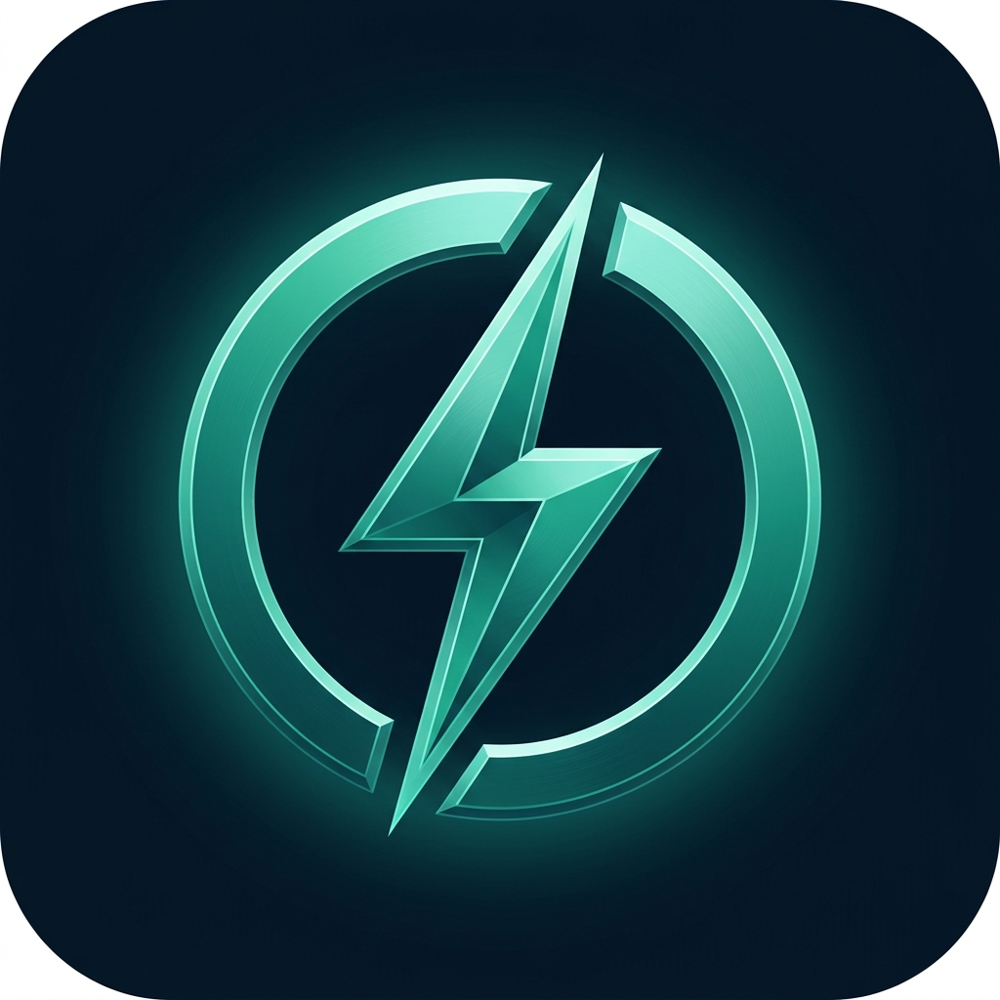
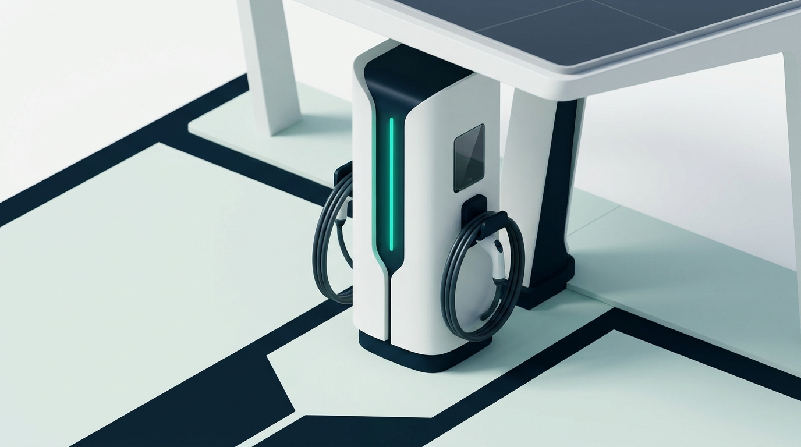

# `static/res/` 前端 UI 素材清单

本目录存放 **EV Charge Hub（新能源汽车充电桩运营服务平台）** 的静态 UI 视觉素材，由 FastAPI 自动挂载至 `/static/res/<filename>`。
所有素材均严格对齐 `static/styles.css` 配色体系（深海藏青 `#0b1923`、能源青绿 `#0a7b6c / #139b88`、钴蓝 `#1864d9`、薄荷浅底 `#eef3f2 / #f5f8f7`），无内置文字与水印，可直接搭配中英文 UI 文案及浅/深色模式使用。

## 素材列表与推荐接入位置

| 文件名 | 尺寸 / 比例 | 体积 | 对应业务线 / 场景 | 推荐页面与位置 |
| :--- | :--- | :--- | :--- | :--- |
| `brand-logo.jpg` | `1024×1024` (1:1) | 483.8 KB | 平台品牌标识 | 侧边栏 `.brand-mark`、浏览器 Favicon（建议配合 `border-radius: 22%` 裁剪外圈白角） |
| `hero-charging-station.jpg` | `1376×768` (16:9) | 428.2 KB | 总览首屏主视觉 | `#panel-home` `.home-hero` 背景或右侧主插画（左侧预留充足留白，便于叠加标题与指标） |
| `station-cover-fast.jpg` | `1376×768` (16:9) | 470.2 KB | 业务线 1 · 直流快充站 | `#driverStationGrid` `.station-card`（含 `DC_FAST` 超充站/光储充示范站封面） |
| `station-cover-slow.jpg` | `1376×768` (16:9) | 442.6 KB | 业务线 1 · 交流/园区慢充站 | `#driverStationGrid` `.station-card`（地下车库/园区慢充站封面） |
| `charging-active.jpg` | `1024×1024` (1:1) | 329.9 KB | 业务线 2 · 扫码开单与计费 | `#startOrderDialog`、`#finishOrderDialog` 或进行中订单状态卡片配图 |
| `ops-maintenance.jpg` | `1200×896` (4:3) | 383.8 KB | 业务线 3 · 设备监控与排障 | `#panel-ops` 运维排障与巡检页头部引导卡片 / 告警工单空态或说明卡 |
| `fleet-coupon.jpg` | `1200×896` (4:3) | 399.0 KB | 业务线 4 · 车队与优惠券 | 车主/企业车队服务卡片、会员优惠券核销活动模块配图 |
| `settle-finance.jpg` | `1200×896` (4:3) | 407.7 KB | 业务线 5 · 结算对账与开票 | `#panel-settle` 月度结算单、对账差异与红冲开票引导区配图 |
| `auth-welcome.jpg` | `1376×768` (16:9) | 478.8 KB | 认证鉴权与角色权限 | `#authDialog` 登录/注册弹窗顶部横幅、或 `#panel-cross` RBAC 实验室引导图 |
| `empty-state.jpg` | `1024×1024` (1:1) | 290.8 KB | 通用空数据占位 | `.empty-hint` 空列表/无查询结果占位插画 |

## 前端引用示例

```html
<!-- 品牌 Logo（建议圆角裁剪） -->


<!-- 场站卡片封面 -->

```
